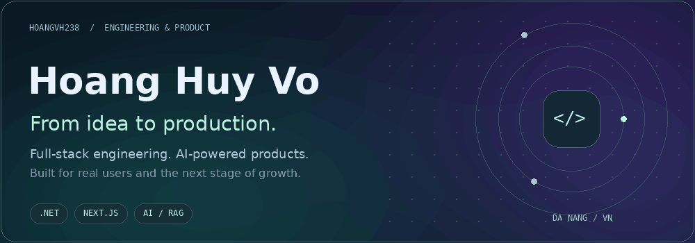
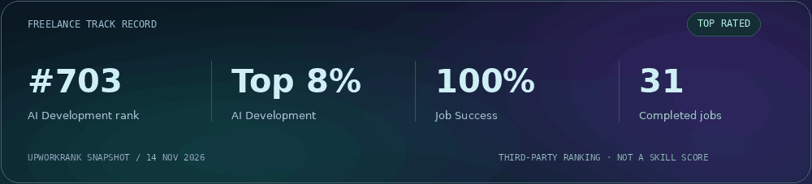

  <picture>
    <source media="(prefers-reduced-motion: reduce)" srcset="assets/hero.png">
    
  </picture>

  <b>Full-Stack Engineer · Backend Architecture · AI-Powered SaaS</b> 
  Helping founders validate ideas, ship useful products, and build for what comes next.

  <a href="https://www.linkedin.com/in/hoangvh238/">LinkedIn</a> &nbsp; / &nbsp;
  <a href="https://github.com/hoangvh238?tab=repositories">Repositories</a> &nbsp; / &nbsp;
  <a href="https://leetcode.com/skynet_dev/">LeetCode</a>

---

### Engineering with the product in mind.

I'm **Hoang**, a full-stack engineer based in **Da Nang, Vietnam**. I build SaaS platforms, AI applications, and automation systems, with a particular focus on the backend architecture that keeps a product dependable as it grows.

My work connects product decisions with implementation: clarify the problem, choose the right scope, ship a useful first version, then improve it with real feedback.

  <picture>
    <source media="(prefers-reduced-motion: reduce)" srcset="assets/rank.png">
    
  </picture>

Snapshot: 14 November 2026 · Animation loops; figures do not update automatically. Category rankings are third-party indicators, not an Upwork endorsement or a technical assessment.

### What I bring to a product

| Build the product | Engineer the intelligence | Strengthen the foundation |
| :--- | :--- | :--- |
| SaaS MVPs and customer-facing applications | LLM applications and RAG pipelines | Backend architecture and API design |
| Marketplaces and enterprise web apps | Document processing and semantic search | Caching, background jobs, and real-time features |
| React / Next.js interfaces backed by robust APIs | AI-assisted workflows and automation | Authentication, authorization, and CI/CD |

### My working stack

| Layer | Tools & approaches |
| :--- | :--- |
| **Backend** | C# · ASP.NET Core · Node.js · NestJS · Python |
| **Frontend** | React · Next.js · TypeScript · Tailwind CSS |
| **Data** | PostgreSQL · SQL Server · Redis · FusionCache |
| **AI & automation** | OpenAI integrations · RAG · Semantic search · Workflow automation |
| **Architecture** | Clean Architecture · SOLID · CQRS · MediatR · Microservices |
| **Platform** | Hangfire · SignalR · JWT / OAuth · RBAC |
| **Delivery** | GitHub Actions · Azure DevOps · CI/CD |

### Where I can help most

- **From idea to MVP:** turn a product hypothesis into a focused, usable release.
- **From prototype to production:** give an AI demo or builder-generated app a maintainable architecture.
- **From fragile to dependable:** address slow APIs, tangled code, and unreliable workflows.
- **From manual to automated:** connect systems and remove repetitive operational work.

### A look at my code

**[microservice-template →](https://github.com/hoangvh238/microservice-template)**  
A public C# repository. Explore the code, structure, and implementation decisions.

**[Explore all repositories →](https://github.com/hoangvh238?tab=repositories)**  
More projects, experiments, and contributions.

### How I work

**01 — Understand** &nbsp; The user, the constraint, and the smallest useful outcome.  
**02 — Design** &nbsp; Clear boundaries, sensible tradeoffs, and room to evolve.  
**03 — Deliver** &nbsp; Working increments, direct communication, and visible progress.  
**04 — Improve** &nbsp; Use feedback and performance evidence to decide what comes next.

---

  <b>Have something worth building?</b> 
  Tell me what you're building, where it stands, and what's getting in the way.  
  <a href="https://www.linkedin.com/in/hoangvh238/"><b>Let's talk →</b></a>  
  Da Nang, Vietnam · UTC+7

